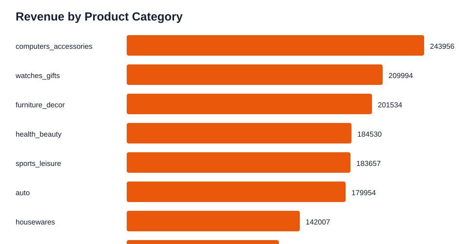
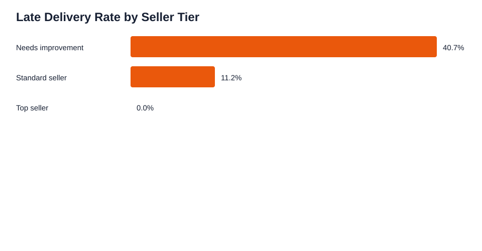

# Olist E-Commerce Data Analytics

Data Analyst portfolio project using Kaggle's **Brazilian E-Commerce Public Dataset by Olist** to analyse sales performance, delivery SLA, customer satisfaction, product categories, seller performance, and retention-style customer behaviour.

Dataset source: [Brazilian E-Commerce Public Dataset by Olist on Kaggle](https://www.kaggle.com/datasets/olistbr/brazilian-ecommerce)

## Business Problem

E-commerce leaders need clear visibility into revenue, delivery performance, seller quality, customer reviews, and product category performance. This project transforms marketplace order data into dashboard-ready KPIs and business recommendations.

## Why This Is a 10/10 Data Analyst Project

- Uses a well-known Kaggle dataset with realistic relational tables.
- Demonstrates SQL joins, KPI reporting, cohort-style logic, and dashboard-ready summaries.
- Covers commercial, operational, and customer experience analysis.
- Includes Python data processing, SQL queries, SVG dashboard previews, and stakeholder recommendations.
- Includes demo data so the repo runs immediately before the Kaggle files are downloaded.

## Executive Summary

This project answers six core business questions:

- Which product categories generate the most revenue?
- Which seller groups create the strongest delivery and review outcomes?
- How does delivery delay affect customer review score?
- Which states and customer segments drive marketplace value?
- What share of orders miss delivery SLA?
- Which actions improve marketplace revenue and customer satisfaction?

## Key Results

| KPI | Value |
| --- | ---: |
| Total Orders | 8,000 |
| Total Revenue | BRL 1,470,569 |
| Average Order Value | BRL 183.82 |
| Late Delivery Rate | 40.3% |
| Average Review Score | 3.94 |
| Repeat Customer Rate | 66.4% |

Top revenue categories in the demo output are `computers_accessories`, `watches_gifts`, `furniture_decor`, `health_beauty`, and `sports_leisure`. Seller performance also shows a clear operational opportunity: sellers in the `Needs improvement` tier generate most revenue but have materially weaker delivery performance than standard and top sellers.

## Dashboard Preview





## Repository Structure

```text
data/
  raw/
  processed/
    orders_enriched.csv
    category_revenue_summary.csv
    seller_performance_summary.csv
    state_customer_summary.csv
    delivery_review_summary.csv
    executive_kpi_summary.csv
dashboard/
  screenshots/
docs/
  kaggle_download_instructions.md
  data_dictionary.md
  dashboard_requirements.md
  business_recommendations.md
  portfolio_scorecard.md
sql/
  ecommerce_analysis_queries.sql
src/
  generate_demo_data.py
  build_ecommerce_analysis.py
```

## Tools Used

- Python: pandas and numpy
- SQL: order joins, revenue KPIs, delivery SLA, seller performance, customer summaries
- Dashboarding: Power BI/Tableau-ready CSV outputs and SVG previews
- Business analysis: stakeholder questions, KPI definitions, business recommendations

## How To Run

Option 1: Use Kaggle data.

1. Download the Kaggle dataset.
2. Place the Olist CSV files in `data/raw/`.
3. Run:

```powershell
python src/build_ecommerce_analysis.py
```

Option 2: Run immediately with demo data.

```powershell
python src/generate_demo_data.py
python src/build_ecommerce_analysis.py
```

## Data Privacy

The Kaggle Olist dataset is public and anonymised. The demo data generated in this repo is synthetic and for portfolio demonstration only.

## Suggested GitHub Topics

`data-analysis`, `ecommerce-analytics`, `sql`, `python`, `power-bi`, `kaggle`, `dashboard`, `business-intelligence`, `customer-analytics`
